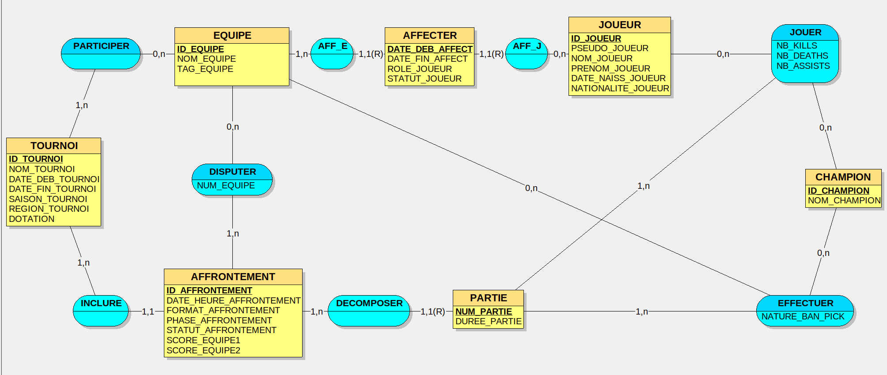
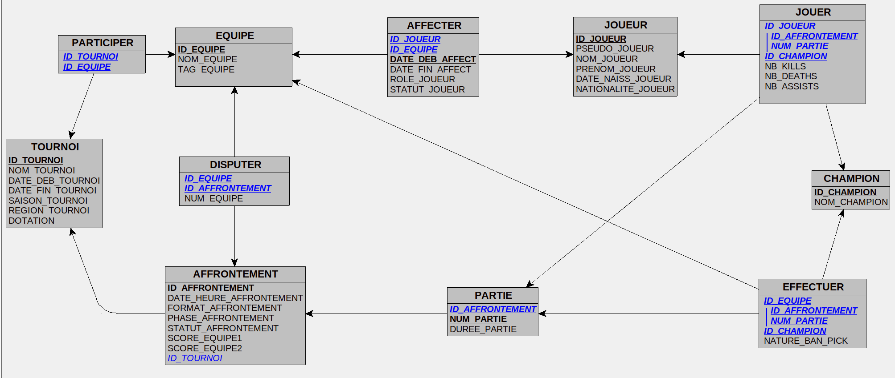
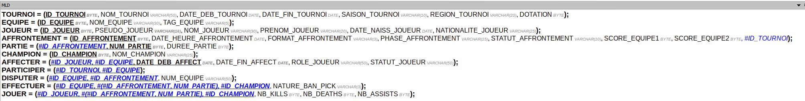
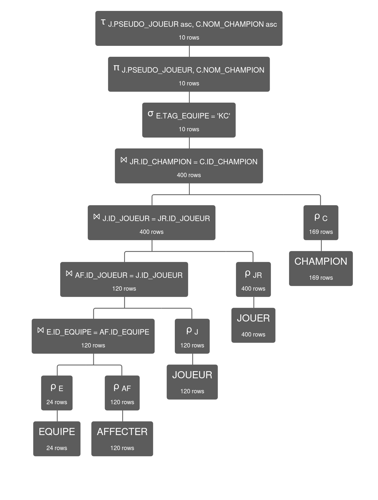
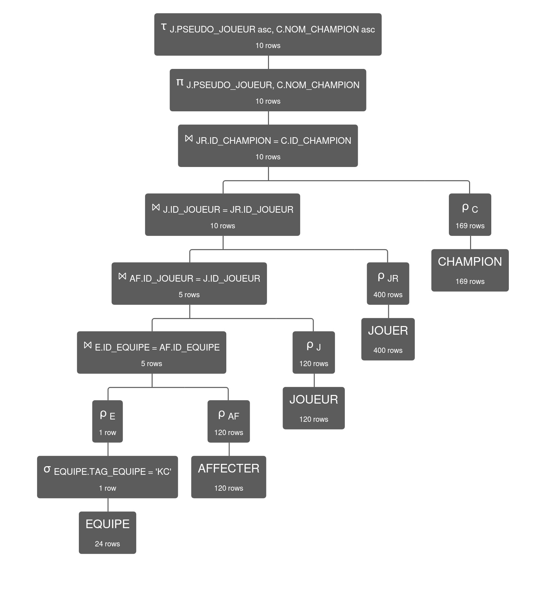

## I. Première étape : analyse des besoins

### Prompt utilisé

```
Tu travailles dans le domaine de l'esport League of Legend. Ton organisation a comme activité d'analyser les compétitions d'esport dans le monde entier sur le jeu vidéo league of Legend. C’est une organisation comme Riot Games, LoL esport. Les données collectées concernent les tournois, équipes, joueurs, champions joués, etc. Inspire-toi du site web suivant : https://www.leagueoflegends.com/fr-fr/.
Ton organisation veut appliquer MERISE pour concevoir un système d'information. Tu es chargé de la partie analyse, c’est-à-dire de collecter les besoins auprès de l’entreprise. Elle a fait appel à un étudiant en ingénierie informatique pour réaliser ce projet, tu dois lui fournir les informations nécessaires pour qu’il applique ensuite lui-même les étapes suivantes de conception et développement de la base de données. 
D’abord, établis les règles de gestions des données de ton organisation, sous la forme d'une liste à puce. Elle doit correspondre aux informations que fournit quelqu’un qui connaît le fonctionnement de l’entreprise, mais pas comment se construit un système d’information.
Ensuite, à partir de ces règles, fournis un dictionnaire de données brutes avec les colonnes suivantes, regroupées dans un tableau : signification de la donnée, type, taille en nombre de caractères ou de chiffres. Il doit y avoir entre 25 et 35 données. Il sert à fournir des informations supplémentaires sur chaque donnée (taille et type) mais sans a priori sur comment les données vont être modélisées ensuite.
Fournis donc les règles de gestion et le dictionnaire de données.
```

### Ce que l’IA a renvoyé

# Analyse MERISE – Système d'information Esport League of Legends

Organisation d'analyse des compétitions esport mondiales sur League of Legends (tournois, équipes, joueurs, champions joués, statistiques de matchs).

## 1. Règles de gestion (RG)

- **RG1** – Un tournoi est organisé par une et une seule ligue régionale (ex. LEC, LCK, LCS, Worlds) et se déroule sur une période donnée, identifiée par une saison (Printemps, Été) et une année.
- **RG2** – Un tournoi est identifié de manière unique par son nom, sa région, sa saison et son année ; deux tournois ne peuvent pas porter le même nom dans la même région, la même saison et la même année.
- **RG3** – Un tournoi met en jeu une dotation (cash prize) connue à l'avance.
- **RG4** – Un tournoi regroupe plusieurs équipes ; une équipe peut participer à plusieurs tournois, y compris dans la même année.
- **RG5** – Une équipe est identifiée par un nom unique, complété par un tag (abréviation) affiché en jeu ; elle appartient à une seule région.
- **RG6** – Une équipe est composée d'au moins cinq joueurs et peut compter des remplaçants ; chaque joueur occupe un poste précis (Top, Jungle, Mid, ADC, Support).
- **RG7** – Un joueur ne peut appartenir qu'à une seule équipe à un instant donné ; en cas de transfert, l'ancienne affectation est clôturée avec une date de fin avant d'enregistrer la nouvelle.
- **RG8** – Un joueur est identifié par son pseudonyme unique ; on conserve également son nom, son prénom, sa nationalité et sa date de naissance.
- **RG9** – Un joueur possède un statut dans son équipe : titulaire ou remplaçant.
- **RG10** – Un match oppose exactement deux équipes différentes dans le cadre d'un seul tournoi.
- **RG11** – Un match se joue selon un format imposé : BO1, BO3 ou BO5 (nombre maximum de parties).
- **RG12** – Un match a lieu à une date et une heure planifiées, dans une phase précise du tournoi (poules, élimination directe, playoffs, finale).
- **RG13** – Un match possède un statut : « à venir », « en cours » ou « terminé » ; seuls les matchs terminés ont un résultat définitif.
- **RG14** – Le résultat d'un match est exprimé par le nombre de parties gagnées par chaque équipe ; l'équipe qui atteint en premier le nombre de victoires requis par le format remporte le match.
- **RG15** – Un match est décomposé en plusieurs parties (games), numérotées dans l'ordre à partir de 1.
- **RG16** – Une partie a une durée, exprimée en minutes, et ne peut être rattachée qu'à un seul match.
- **RG17** – Dans chaque partie, chaque équipe effectue des interdictions de champions (bans) et des sélections de champions (picks).
- **RG18** – Dans une partie, chaque joueur joue exactement un champion, dans un rôle donné.
- **RG19** – Un champion est identifié par un nom unique ; un même champion peut être joué par plusieurs joueurs, dans plusieurs parties, mais ne peut être sélectionné qu'une fois par partie.
- **RG20** – Un champion banni dans une partie ne peut pas être joué dans cette même partie.
- **RG21** – Pour chaque joueur et chaque partie, on enregistre des statistiques individuelles : nombre d'éliminations (kills), nombre de morts (deaths) et nombre d'aides (assists).
- **RG22** – Les statistiques d'un joueur ne sont valables que pour une partie donnée ; elles ne sont saisies qu'une fois la partie terminée.
- **RG23** – Les données conservées servent aux analyses de l'organisation : les historiques de matchs, de compositions et de performances ne sont jamais supprimés, même après la fin d'un tournoi ou le départ d'un joueur d'une équipe.

## 2. Dictionnaire des données brutes


| N°  | Code donnée         | Signification de la donnée                                       | Type   | Taille                   |
| --- | ------------------- | ---------------------------------------------------------------- | ------ | ------------------------ |
| 1   | ID\_TOURNOI         | Identifiant unique du tournoi                                    | Entier | 4 chiffres               |
| 2   | NOM\_TOURNOI        | Nom du tournoi (ex. « Worlds », « LCK Spring »)                  | Texte  | 50 caractères            |
| 3   | DATE\_DEB\_TOURNOI  | Date de début du tournoi                                         | Date   | 8 (JJMMAAAA)             |
| 4   | DATE\_FIN\_TOURNOI  | Date de fin du tournoi                                           | Date   | 8 (JJMMAAAA)             |
| 5   | SAISON\_TOURNOI     | Saison du tournoi (Printemps / Été)                              | Texte  | 10 caractères            |
| 6   | REGION\_TOURNOI     | Région / ligue organisatrice (LEC, LCK, LCS, etc.)               | Texte  | 20 caractères            |
| 7   | DOTATION            | Dotation totale du tournoi en dollars                            | Entier | 7 chiffres               |
| 8   | ID\_EQUIPE          | Identifiant unique de l'équipe                                   | Entier | 4 chiffres               |
| 9   | NOM\_EQUIPE         | Nom complet de l'équipe                                          | Texte  | 30 caractères            |
| 10  | TAG\_EQUIPE         | Abréviation / tag de l'équipe affiché en jeu (ex. G2, T1)        | Texte  | 5 caractères             |
| 11  | ID\_JOUEUR          | Identifiant unique du joueur                                     | Entier | 5 chiffres               |
| 12  | PSEUDO\_JOUEUR      | Pseudonyme du joueur en jeu (ex. Faker)                          | Texte  | 16 caractères            |
| 13  | NOM\_JOUEUR         | Nom de famille du joueur                                         | Texte  | 30 caractères            |
| 14  | PRENOM\_JOUEUR      | Prénom du joueur                                                 | Texte  | 20 caractères            |
| 15  | DATE\_NAISS\_JOUEUR | Date de naissance du joueur                                      | Date   | 8 (JJMMAAAA)             |
| 16  | NATIONALITE\_JOUEUR | Nationalité du joueur                                            | Texte  | 25 caractères            |
| 17  | ROLE\_JOUEUR        | Poste du joueur (Top, Jungle, Mid, ADC, Support)                 | Texte  | 10 caractères            |
| 18  | STATUT\_JOUEUR      | Statut du joueur dans l'équipe (titulaire / remplaçant)          | Texte  | 10 caractères            |
| 19  | DATE\_DEB\_AFFECT   | Date de début d'affectation du joueur dans l'équipe              | Date   | 8 (JJMMAAAA)             |
| 20  | DATE\_FIN\_AFFECT   | Date de fin d'affectation du joueur dans l'équipe (si départ)    | Date   | 8 (JJMMAAAA)             |
| 21  | ID\_MATCH           | Identifiant unique du match                                      | Entier | 6 chiffres               |
| 22  | DATE\_HEURE\_MATCH  | Date et heure planifiées du match                                | Date   | 12 (JJMMAAAAHHMM)        |
| 23  | FORMAT\_MATCH       | Format du match (BO1, BO3, BO5)                                  | Texte  | 3 caractères             |
| 24  | PHASE\_MATCH        | Phase du tournoi (poules, élimination directe, playoffs, finale) | Texte  | 15 caractères            |
| 25  | STATUT\_MATCH       | Statut du match (à venir, en cours, terminé)                     | Texte  | 10 caractères            |
| 26  | SCORE\_EQUIPE1      | Nombre de parties gagnées par la première équipe                 | Entier | 1 chiffre                |
| 27  | SCORE\_EQUIPE2      | Nombre de parties gagnées par la seconde équipe                  | Entier | 1 chiffre                |
| 28  | NUM\_PARTIE         | Numéro de la partie dans le match (1, 2, 3…)                     | Entier | 2 chiffres               |
| 29  | DUREE\_PARTIE       | Durée de la partie en minutes                                    | Entier | 3 chiffres               |
| 30  | ID\_CHAMPION        | Identifiant unique du champion                                   | Entier | 4 chiffres               |
| 31  | NOM\_CHAMPION       | Nom du champion (ex. Ahri, Yasuo)                                | Texte  | 25 caractères            |
| 32  | NATURE\_BAN\_PICK   | Indique si le champion a été banni ou sélectionné pour la partie | Texte  | 3 caractères (BAN / PIK) |
| 33  | NB\_KILLS           | Nombre d'éliminations réalisées par le joueur dans la partie     | Entier | 2 chiffres               |
| 34  | NB\_DEATHS          | Nombre de morts du joueur dans la partie                         | Entier | 2 chiffres               |
| 35  | NB\_ASSISTS         | Nombre d'aides du joueur dans la partie                          | Entier | 2 chiffres               |


*Remarque : ce dictionnaire est « brut » — il décrit les données utiles à l'organisation sans préjuger du modèle conceptuel des données (MCD) qui sera construit par la suite.*

## II. Deuxième étape : MCD


*Image du MCD réaliser sur le logiciel Looping*


## III. Troisième étape : MLD et MPD



*Image du MLD obtenus grâce au logiciel Looping*

MPD en SQL déduis du MLD : 
 [1_creation.sql](./1_creation.sql)

Contraintes de validation : 
 [2_contraintes.sql](./2_contraintes.sql)

## IV. Quatrième étape : insertion des données

### Prompt

```
Donne les requêtes d’insertion permettant de remplir la base de données dont le modèle relationnel est le suivant : 
TOURNOI = ([PK] ID_TOURNOI BYTE, NOM_TOURNOI VARCHAR(50), DATE_DEB_TOURNOI DATE, DATE_FIN_TOURNOI DATE, SAISON_TOURNOI VARCHAR(10), REGION_TOURNOI VARCHAR(20), DOTATION BYTE);

EQUIPE = ([PK] ID_EQUIPE BYTE, NOM_EQUIPE VARCHAR(30), TAG_EQUIPE VARCHAR(5));

JOUEUR = ([PK] ID_JOUEUR BYTE, PSEUDO_JOUEUR VARCHAR(16), NOM_JOUEUR VARCHAR(30), PRENOM_JOUEUR VARCHAR(20), DATE_NAISS_JOUEUR DATE, NATIONALITE_JOUEUR VARCHAR(25));

AFFRONTEMENT = ([PK] ID_AFFRONTEMENT BYTE, DATE_HEURE_AFFRONTEMENT DATE, FORMAT_AFFRONTEMENT VARCHAR(3), PHASE_AFFRONTEMENT VARCHAR(15), STATUT_AFFRONTEMENT VARCHAR(10), SCORE_EQUIPE1 BYTE, SCORE_EQUIPE2 BYTE, #ID_TOURNOI);

PARTIE = ([PK] #ID_AFFRONTEMENT, [PK] NUM_PARTIE BYTE, DUREE_PARTIE BYTE);

CHAMPION = ([PK] ID_CHAMPION BYTE, NOM_CHAMPION VARCHAR(25));

AFFECTER = ([PK] #ID_JOUEUR, [PK] #ID_EQUIPE, [PK] DATE_DEB_AFFECT DATE, DATE_FIN_AFFECT DATE, ROLE_JOUEUR VARCHAR(50), STATUT_JOUEUR VARCHAR(50));

PARTICIPER = ([PK] #ID_TOURNOI, [PK] #ID_EQUIPE);

DISPUTER = ([PK] #ID_EQUIPE, [PK] #ID_AFFRONTEMENT, NUM_EQUIPE VARCHAR(50));

EFFECTUER = ([PK] #ID_EQUIPE, [PK] #ID_AFFRONTEMENT, [PK] NUM_PARTIE, [PK] #ID_CHAMPION, NATURE_BAN_PICK VARCHAR(3));

JOUER = ([PK] #ID_JOUEUR, [PK] (#ID_AFFRONTEMENT, NUM_PARTIE), [PK] #ID_CHAMPION, NB_KILLS BYTE, NB_DEATHS BYTE, NB_ASSISTS BYTE);

Remplis la base de donnée en utilisant des données existantes. Il faut :
- Tout les tournois des deux dernières années (Winter Splits, CBLOL Cup 2026, LCS 2026 Lock-In, First Stand 2026, Spring Splits, Mid-Season Invitational (MSI 2026), Esports World Cup (EWC 2026), Summer Splits, EMEA Masters Summer 2026, League of Legends World Championship (Worlds 2026), Coupe Demacia 2026, Esports Nations Cup 2026)
- les équipes ayant participé à ces tournois (au moins 20)
- Tout les joueurs présent dans ces équipes (au moins 100 joueurs)
- Au moins 10 affrontements par tournoi
- Toutes les parties que contiennent ces affrontements avec pour chaque partie toutes les données NB_KILLS, NB_DEATHS, NB_ASSISTS, NATURE_BAN_PICK
- Tout les champions du jeu League of Legends
Ajoute également quelques données concernant les années précédents 2026 (entre 2020 et 2026). Il ne faut pas plus de 2000 lignes au total.

Les clés étrangères doivent faire référence aux clés primaires existantes : donne les lignes en commençant par remplir les tables dans lesquelles il n'y a pas de clés étrangères, puis les tables dans lesquelles les clés étrangères font références à des clés primaires des tables déjà remplies. 

Les données doivent respecter les contraintes de validation suivantes :
ALTER TABLE TOURNOI
    ADD CONSTRAINT CK_TOURNOI_DATES
    CHECK (DATE_FIN_TOURNOI IS NULL OR DATE_FIN_TOURNOI >= DATE_DEB_TOURNOI);

ALTER TABLE TOURNOI
    ADD CONSTRAINT CK_TOURNOI_DOTATION
    CHECK (DOTATION >= 0);

ALTER TABLE EQUIPE
    ADD CONSTRAINT CK_EQUIPE_TAG
    CHECK (CHAR_LENGTH(TAG_EQUIPE) BETWEEN 2 AND 5);

ALTER TABLE AFFRONTEMENT
    ADD CONSTRAINT CK_AFFRONTEMENT_FORMAT
    CHECK (FORMAT_AFFRONTEMENT IN ('BO1', 'BO3', 'BO5'));

ALTER TABLE AFFRONTEMENT
    ADD CONSTRAINT CK_AFFRONTEMENT_STATUT
    CHECK (STATUT_AFFRONTEMENT IN ('PLANIFIE', 'EN_COURS', 'TERMINE'));

ALTER TABLE AFFRONTEMENT
    ADD CONSTRAINT CK_AFFRONTEMENT_PHASE
    CHECK (PHASE_AFFRONTEMENT IN ('POULES', 'PLAYOFFS', 'DEMI_FINALE', 'FINALE'));

ALTER TABLE DISPUTER
    ADD CONSTRAINT CK_DISPUTER_NUM_EQUIPE
    CHECK (NUM_EQUIPE IN (1, 2));

ALTER TABLE AFFRONTEMENT
    ADD CONSTRAINT CK_AFFRONTEMENT_SCORES
    CHECK (SCORE_EQUIPE1 >= 0 AND SCORE_EQUIPE2 >= 0);

ALTER TABLE AFFECTER
    ADD CONSTRAINT CK_AFFECTER_DATES
    CHECK (DATE_FIN_AFFECT IS NULL OR DATE_FIN_AFFECT >= DATE_DEB_AFFECT);

ALTER TABLE AFFECTER
    ADD CONSTRAINT CK_AFFECTER_ROLE
    CHECK (ROLE_JOUEUR IN ('TOP', 'JUNGLE', 'MID', 'ADC', 'SUPPORT', 'COACH'));

ALTER TABLE AFFECTER
    ADD CONSTRAINT CK_AFFECTER_STATUT
    CHECK (STATUT_JOUEUR IN ('ACTIF', 'BANC', 'PARTI'));

ALTER TABLE PARTIE
    ADD CONSTRAINT CK_PARTIE_NUM
    CHECK (NUM_PARTIE >= 1);

ALTER TABLE PARTIE
    ADD CONSTRAINT CK_PARTIE_DUREE
    CHECK (DUREE_PARTIE > '00:00:00' AND DUREE_PARTIE < '02:00:00');

ALTER TABLE EFFECTUER
    ADD CONSTRAINT CK_EFFECTUER_NATURE
    CHECK (NATURE_BAN_PICK IN ('BAN', 'PICK'));


ALTER TABLE EFFECTUER
    ADD CONSTRAINT UQ_CHAMPION_PARTIE
        UNIQUE (ID_AFFRONTEMENT, NUM_PARTIE, ID_CHAMPION);

Fournis l'ensemble sous la forme d’un script SQL prêt à être exécuté.
```

### Ce que l’IA a renvoyé

Résultat obtenu stocké dans le fichier : 
 [3_insertion.sql](./3_insertion.sql)

## V. Cinquième étape : interrogation de la BD

Scénario : le head coach de la Karmine Corp prépare le roster de la saison 2027. Il scout les joueurs du monde entier, compare les équipes adverses et analyse leurs joueurs pour préparer les futurs matchs.

Les requêtes sont disponibles dans la fichier [4_interrogation.sql](./4_interrogation.sql)

Interessons nous à la requête permettant de connaitre les champions joués par les joueurs de la KC.

Elle utilise trois opérateurs différents : la **sélection (σ)**, la **jointure (⋈)**, la **projection (π)** et le **tri (τ)**.

### 1. Plan d'exécution initial

Dans ce premier plan, les jointures sont effectuées avant la sélection de l'équipe KC.

La requête SQL est la suivante :  
``` SQL
SELECT DISTINCT J.PSEUDO_JOUEUR, C.NOM_CHAMPION
    FROM EQUIPE AS E
    JOIN AFFECTER AS AF ON E.ID_EQUIPE = AF.ID_EQUIPE
    JOIN JOUEUR AS J ON AF.ID_JOUEUR = J.ID_JOUEUR
    JOIN JOUER AS JR ON J.ID_JOUEUR = JR.ID_JOUEUR
    JOIN CHAMPION AS C ON JR.ID_CHAMPION = C.ID_CHAMPION
        WHERE E.TAG_EQUIPE = 'KC'
        ORDER BY J.PSEUDO_JOUEUR, C.NOM_CHAMPION;
```  


*Arbre relationnel de la requête ci-dessus*

**Calcul du coût :**

En considérant une jointure par boucles imbriquées (produit des cardinalités en entrée), une comparaison par ligne pour la sélection et deux opérations par ligne pour la projection :

| Opération | Calcul du coût | Coût |
|---|---:|---:|
| E ⋈ AF | $24 * 120$ | $1 880$ |
| Table précédente ⋈ J | $120 * 120$ | $14 400$ |
| Table précédente ⋈ JR | $120 * 400$ | $48 000$ |
| Table précédente ⋈ C | $400 * 169$ | $67 700$ |
| σ Table précédente | $400$ | $400$ | 
| π Table précédente | $10$ | $10$ |
| τ tri résultat | $10 \log_2(10)$ | $33$ |
| Total || $132 423$ |


### 2. Plan d'exécution optimisé

Dans le deuxième plan, la sélection est effectuée dès le départ sur la table EQUIPE. Cela permet de réduire le nombre de lignes avant les jointures.

La requête SQL est la suivante :  
``` SQL
SELECT DISTINCT J.PSEUDO_JOUEUR, C.NOM_CHAMPION
    FROM (SELECT * FROM EQUIPE WHERE EQUIPE.TAG_EQUIPE = 'KC') AS E
    JOIN AFFECTER AS AF ON E.ID_EQUIPE = AF.ID_EQUIPE
    JOIN JOUEUR AS J ON AF.ID_JOUEUR = J.ID_JOUEUR
    JOIN JOUER AS JR ON J.ID_JOUEUR = JR.ID_JOUEUR
    JOIN CHAMPION AS C ON JR.ID_CHAMPION = C.ID_CHAMPION
        ORDER BY J.PSEUDO_JOUEUR, C.NOM_CHAMPION;
``` 


*Arbre relationnel de la requête ci-dessus*

**Calcul du coût :**

| Opération | Calcul du coût | Coût |
|---|---:|---:|
| σ EQUIPE| $24$ | $24$ | 
| Table précédente ⋈ AF | $1 * 120$ | $120$ |
| Table précédente ⋈ J | $5 * 120$ | $600$ |
| Table précédente ⋈ JR | $5 * 400$ | $2 000$ |
| Table précédente ⋈ C | $10 * 169$ | $1 690$ |
| π Table précédente | $10$ | $10$ |
| τ tri résultat | $10 \log_2(10)$ | $33$ |
| Total || $4 477$ |


Le deuxième plan est nettement plus performant.

Cette différence s'explique par le fait que la sélection est effectuée avant les jointures. Elle réduit immédiatement la table EQUIPE de 24 à 1 ligne, ce qui diminue la taille des relations intermédiaires.
